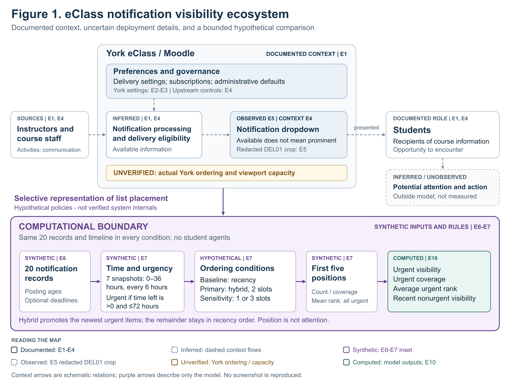
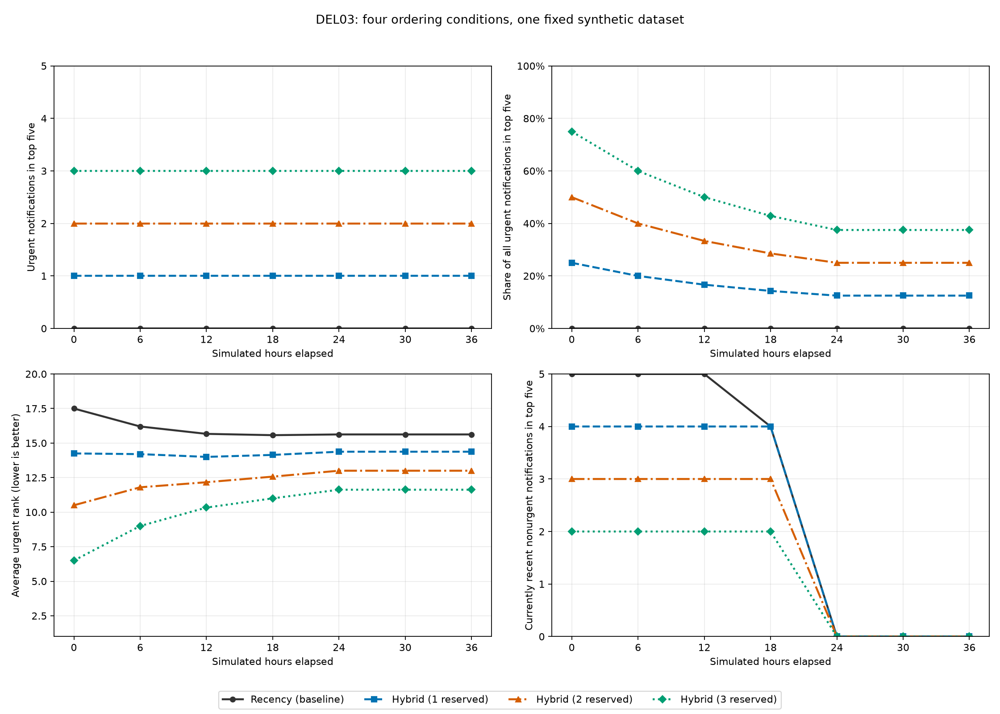

# EECS 4461 DEL03.1 Final Integrated Dossier - draft

## Urgent information and limited display capacity in a synthetic eClass-style notification list

Joint project by Adejumobi and Methunan Uthayakumar. Draft revised November 23, 2026. Primary comparison: recency baseline versus hybrid with two reserved urgent positions; hybrid with one or three positions provides sensitivity checks. This is a controlled synthetic representation, not a reconstruction of York's actual algorithm. The final DEL03 release remains pending.

## §1. Final inquiry, context, and boundary

**Inquiry:** In a fixed synthetic list of 20 course notifications, how does reserving two of the first five positions for the newest urgent notifications change urgent information's opportunity for visibility compared with recency ordering, and what visible space does that allocation remove from recent nonurgent information?

The focal arrangement is the student-facing notification dropdown in York University's eClass environment. York documentation supplies institutional context and information about notification preferences; the supplied interface record supports the visible dropdown and its controls (*York eClass notification dropdown*, n.d.; York University, n.d.-a, n.d.-b; E1-E2, E5). Students are recipients, instructors/course staff originate course information, and notification processing and interface presentation mediate encounter opportunities. Student attention and action remain outside the computation.

The investigation examines allocation of limited display capacity, rather than whether a notification exists at all. The main alternative is hybrid-2; hybrid-1 and hybrid-3 vary that capacity to test sensitivity. All four conditions use the same records and timeline.

The earlier DEL01 plan proposed recency, urgency-class-first and hybrid ordering at volumes 10, 20 and 40. Its primary alternative already reserved two urgent positions. The completed scope retains volume 20 and the recency/hybrid-2 comparison, adding reserved-slot sensitivity while deferring urgency-only ordering and other volumes (*Urgency vs. recency*, n.d.; E13). DEL01 grading feedback identified DEL01-4 as partially demonstrated because the three proposed ordering methods were insufficiently explained. The definitions in §§2.2 and 3.1 address that feedback by specifying the rules and separating proposed from implemented conditions; this does not change the earlier grade.

## §2. Evidence and representation

### §2.1. Evidence sources and use

Official sources document context, not our hypothetical ranking policies. E5 is observed interface evidence with disclosed redactions; E6-E7 are synthetic; E9-E10 are computationally derived; E11 supports implementation verification. A visually observed item or documented feature is not evidence of student reading.

The public E5 file is `docs/evidence/DEL01_eClass_notification_dropdown_E5_public_redacted.png`. Its [record](evidence/records/E5_observed_del01_screenshot.md) explains cropping, opaque masks and provenance. Course-identifying content and absolute schedules are hidden; generic content-change/quiz text, relative timestamps, controls, scrollbar and See all remain. The exact capture date and photographer are unconfirmed. October 2026 is the user-reported original upload/work period, not an inferred capture date. The unredacted source is held privately outside the repository.

### §2.1.1. APA-style reference list

References are alphabetized by author or, where authorship is unconfirmed, title; n.d. denotes an unestablished source date. Joint project development does not establish the creator of every individual source or image. E-labels supplement author–date citations. Published sources have URLs; local inputs have saved records. E4 identifies an upstream documentation version, not York's deployed Moodle version.

**E12** Baljko, M. (n.d.). *EECS 4461 F26: DEL03.1 final integrated dossier report* [Course specification]. York University. Locally supplied course PDF: `05_Deliverable3.1 - Final Integrated Dossier Report.pdf`. Saved requirement record: [E12_del03_specification.md](evidence/records/E12_del03_specification.md).

**E8** *Boltzmann wealth model (tutorial)* [Computer software; commit fe24c24ee34762de2ff85d487af14bfb5cd1dbb2]. (n.d.). Mesa. [https://github.com/mesa/mesa/tree/fe24c24ee34762de2ff85d487af14bfb5cd1dbb2/mesa/examples/basic/boltzmann_wealth_model](https://github.com/mesa/mesa/tree/fe24c24ee34762de2ff85d487af14bfb5cd1dbb2/mesa/examples/basic/boltzmann_wealth_model)

**E9** Cedrion. (2026, November 7). *DEL02 release* (DEL02) [Computer software]. GitHub. [https://github.com/methu28/eclass-notification-model/releases/tag/DEL02](https://github.com/methu28/eclass-notification-model/releases/tag/DEL02)

**E10** *DEL03: Reserved urgent position comparison* [Unpublished project report and computational outputs]. (n.d.). eclass-notification-model. Saved output record: [E10_del03_computational_outputs.md](evidence/records/E10_del03_computational_outputs.md); report: [del03_results.md](del03_results.md).

**E11** *Implementation verification record* [Project verification documentation]. (2026, November 22). eclass-notification-model. [E11_implementation_verification.md](evidence/records/E11_implementation_verification.md).

**E7** *Model design and assumptions* [Project documentation and implemented rule definitions]. (n.d.). eclass-notification-model. Saved record: [E7_synthetic_rules.md](evidence/records/E7_synthetic_rules.md); source account: [model_design.md](model_design.md).

**E4** Notifications. (2025, September 1). In *MoodleDocs* (Moodle 4.5 documentation). Retrieved November 22, 2026, from [https://docs.moodle.org/405/en/Notifications](https://docs.moodle.org/405/en/Notifications)

**E6** *Synthetic notification dataset* [Project dataset; data/notifications.csv]. (n.d.). eclass-notification-model. Saved input record: [E6_synthetic_dataset.md](evidence/records/E6_synthetic_dataset.md); canonical data: [notifications.csv](../data/notifications.csv).

**E13** *Urgency vs. recency: How notification ordering rules affect the visibility of important course information in eClass* [DEL01 inquiry plan]. (n.d.). eclass-notification-model. Local source: `Deliverable 1 hypermedia.pdf`; [saved record](evidence/records/E13_del01_inquiry_plan.md).

**E5** *York eClass notification dropdown* [Cropped, redacted DEL01 interface screenshot]. (n.d.). eclass-notification-model. [Saved image: DEL01_eClass_notification_dropdown_E5_public_redacted.png](evidence/DEL01_eClass_notification_dropdown_E5_public_redacted.png).

**E2** York University. (n.d.-a). *How to change my email notification settings*. Learning Technology Services. Retrieved November 22, 2026, from [https://lthelp.yorku.ca/how-to-change-my-email-notification-settings](https://lthelp.yorku.ca/how-to-change-my-email-notification-settings)

**E1** York University. (n.d.-b). *Learning technologies*. University Information Technology. Retrieved November 22, 2026, from [https://www.yorku.ca/uit/student-services/learning-technologies/](https://www.yorku.ca/uit/student-services/learning-technologies/)

**E3** York University. (n.d.-c). *Manage forum notifications*. Learning Technology Services. Retrieved November 22, 2026, from [https://lthelp.yorku.ca/forum-students/managing-forum-notifications](https://lthelp.yorku.ca/forum-students/managing-forum-notifications)

### §2.1.2. Evidence inventory

Saved records in `docs/evidence/records/` identify supported claims and uncertainty. The columns follow the course specification exactly (Baljko, n.d.; E12).

| Evidence label and source or input | Status | Role in the model | Limit or uncertainty |
|---|---|---|---|
| E1 - York University (n.d.-b), Learning technologies; [E1_york_context.md](evidence/records/E1_york_context.md) | Documented; official source checked online | Institutional setting and Moodle connection for the ecosystem | No verified deployment version or ranking behavior |
| E2 - York University (n.d.-a), email notification settings; [E2_york_notification_preferences.md](evidence/records/E2_york_notification_preferences.md) | Documented; official source checked online | Identifies delivery preferences omitted from the model | Email controls do not establish bell-list ordering |
| E3 - York University (n.d.-c), forum notifications; [E3_york_forum_governance.md](evidence/records/E3_york_forum_governance.md) | Documented; official source checked online | Subscription and digest governance in the surrounding arrangement | Not a priority-ranking rule or a complete account of all notifications |
| E4 - Notifications (2025), MoodleDocs; [E4_moodle_notifications.md](evidence/records/E4_moodle_notifications.md) | Documented upstream behavior | Generic notification-interface/governance context | Moodle 4.5 reference is not evidence of York's exact deployment |
| E5 - York eClass notification dropdown (n.d.); [E5 record](evidence/records/E5_observed_del01_screenshot.md), image `DEL01_eClass_notification_dropdown_E5_public_redacted.png` | Observed cropped, opaquely redacted derivative; private original retained outside repository | Supports visible dropdown entry areas, generic types, relative timestamps, controls and scrollbar | Capture date/author/viewport unconfirmed; redactions hide course details; no internal algorithm, universal capacity or attention claim |
| E6 - Synthetic notification dataset (n.d.); [E6_synthetic_dataset.md](evidence/records/E6_synthetic_dataset.md) | Synthetic; canonical input present | Supplies the same 20 records to all four conditions | Constructed contrast, not a sample or prevalence estimate |
| E7 - Model design and assumptions (n.d.); [E7_synthetic_rules.md](evidence/records/E7_synthetic_rules.md) | Synthetic modelling choices; implemented | Specifies recency, urgency classification, hybrid K=1/2/3, clock and metrics | Does not identify real eClass rules; no separate urgency-only ordering |
| E8 - Boltzmann wealth model (tutorial) (n.d.); [E8_mesa_provenance.md](evidence/records/E8_mesa_provenance.md) | Documented technical provenance | Model/agent/activation/data-collection lineage | Does not validate notification assumptions |
| E9 - Cedrion (2026), DEL02 release; [E9_del02_snapshot.md](evidence/records/E9_del02_snapshot.md) | Computationally derived; preserved published snapshot | Earlier recency/hybrid-2 results and baseline provenance | Synthetic experiment; release account is not sole-authorship evidence |
| E10 - DEL03: Reserved urgent position comparison (n.d.); [E10_del03_computational_outputs.md](evidence/records/E10_del03_computational_outputs.md) | Computationally derived; local uncommitted artifacts | Four-condition sensitivity evidence and parameter/input identity | One deterministic dataset; no empirical replication or student outcomes |
| E11 - Implementation verification record (2026); [E11_implementation_verification.md](evidence/records/E11_implementation_verification.md) | Documented prior implementation checks | Supports internal consistency and reproducibility | Verification is not external validation; no new test run claimed for this documentation task |
| E12 - Baljko (n.d.), DEL03.1 specification; [E12_del03_specification.md](evidence/records/E12_del03_specification.md) | Documented course requirement; local PDF inspected | Determines dossier table, assumption-record and map requirements | Not evidence of eClass behavior; no public handout URL supplied |
| E13 - Urgency vs. recency (n.d.), DEL01 inquiry plan; [saved record](evidence/records/E13_del01_inquiry_plan.md) | Documented earlier synthetic proposal | Verifies original urgency-class-first rule and earlier scope; separates proposed and implemented methods | Local source PDF not published; document-specific authorship/date unconfirmed; supplied grading feedback does not validate the model |

### §2.2. Final computational representation

#### §2.2.1. Representation overview

This model represents 20 synthetic course notifications as passive Mesa agents whose temporal state and display ranks update under a recency baseline and a hybrid-2 alternative, with hybrid-1/3 sensitivity conditions. It does not represent the actual eClass algorithm, student attention or behavior, or notification arrivals and removals.

The preserved Boltzmann Wealth example supplies a technical model/agent/step/data-collection pattern, not an analogy between wealth and attention (*Boltzmann wealth model (tutorial)*, n.d.; E8). Notifications update their ages and remaining deadline times; the model centrally assigns rank and collects model/agent states. There are no student agents or interactions between human decision-makers.

#### §2.2.2. Representation ledger

| Model component or assumption | What it does in the model | Evidence or input | Status and limit |
|---|---|---|---|
| Notification-list referent | Selects course-information display as the arrangement examined | E1 institutional context; E4 upstream menu; E5 observed redacted DEL01 crop | Observed interface elements support the referent; the model remains a selective abstraction, not the actual platform pipeline |
| Passive notification entities | Gives each record age, deadline, urgency, rank and visibility state | E6; E7; E8 technical pattern | Synthetic representation, not human decision-making |
| Same fixed population of 20 | Controls input volume across all four conditions | E6; E7 | Synthetic choice to isolate ordering; not measured traffic |
| Categories, posting ages and optional deadlines | Supplies heterogeneous information and temporal attributes | E6 | Synthetic inputs; no verified mapping of every category to a York bell event |
| Four initially urgent plus four later threshold crossings | Produces a changing urgency population within the fixed list | E6; E7 | Constructed contrast; not a population proportion |
| Urgency within 72 hours and strictly before deadline | Classifies items at initialization and each step | E7 | Synthetic operational definition; not a York policy or an urgency-only sorting condition |
| Newest-first recency | Assigns the baseline list order with ID tie-breaking | E7 | Hypothetical baseline; not verified platform behavior |
| Hybrid K=1,2,3 | Promotes K newest urgent items and fills the rest by recency without duplicates; K=2 primary, K=1/3 sensitivity | E7; E10 | Synthetic alternative family; newest urgent is not nearest deadline |
| Five visible positions | Limits the measured region to ranks 1-5 | E7 synthetic choice; E5 records one redacted cropped interface state | Synthetic fixed-capacity proxy; E5 shows four entries in this crop and does not establish a universal capacity |
| Six six-hour steps plus initial snapshot | Advances time over 36 hours and reranks | E7 | Synthetic discretization; no user checking schedule |
| Urgent visible count and coverage | Counts urgent items in ranks 1-5 and divides by all currently urgent items | E7; E10 | Computational measures, not attention or reading; denominator changes over time |
| Mean urgent rank | Averages positions of all currently urgent items | E7; E10 | Computational measure; cross-time changes can reflect changed membership |
| Current recent nonurgent age at most 24 hours | Measures recent nonurgent entries in ranks 1-5 | E7 | Synthetic recency window; zeros can reflect aging rather than displacement |
| Initial recent nonurgent cohort | Keeps initial cohort membership fixed and measures its visible count | E6; E7 | Synthetic analytical cohort, not a user group; separates aging from displacement |
| No arrivals, deletions, read-state changes or overdue items in default run | Isolates ranking and threshold transitions | E7 | Deliberate simplification; recency order stays fixed without arrivals |
| No delivery eligibility or preference simulation | Gives each condition identical available records | E7; E2-E4 provide omitted context | Synthetic boundary; surrounding channel governance is not implemented |
| No student behavior or educational outcomes | Ends the computational measurement at list position | E7 | Explicit omission; cannot infer noticing, reading, missed deadlines or grades |
| Deterministic repeated execution and shared inputs | Makes runs comparable and reproducible | E6; E7; E11 | Verified implementation property; repeated runs are not independent empirical samples |
| Original Mesa example preserved separately | Supplies implementation provenance without importing wealth dynamics into the inquiry | E8 | Technical lineage only; no wealth/attention analogy is validated |

#### §2.2.3. Modelling assumptions

Each choice below states its analytical rationale and status. These are operational choices for this inquiry, not facts about York's implementation (E6-E7).

1. **Fixed 20 synthetic records:** isolates ordering while holding the information collection constant. This is a synthetic control, not a typical workload estimate.
2. **Constructed ages/deadlines:** older urgent items compete with newer nonurgent items, allowing the trade-off to be inspected. The initial four urgent records are 20% of the list, but urgency grows during execution; the proportion is not held at 20% throughout.
3. **Urgency at 0 < hours remaining <=72:** supplies a clear approaching-deadline classification. This is synthetic, does not capture every kind of importance, and is not a platform policy.
4. **First five positions:** supplies one fixed scarce-capacity window. It is a visibility proxy, not a measured universal viewport; E5 retains four entry areas in one cropped state.
5. **Recency/hybrid-2 with hybrid-1/3 sensitivity:** varies capacity allocated to urgency while retaining recency elsewhere. These are hypothetical arrangements; two slots is the focal comparison, not a proven optimum.
6. **Seven snapshots over 36 hours, six hours apart:** observes the constructed threshold crossings before the first deadline. This is a synthetic horizon, not a user-checking interval.
7. **Recent means age <=24 hours:** operationalizes one competing information class. The separate fixed initial cohort distinguishes displacement from aging out of that window.
8. **No arrivals, deletions, read-state changes or overdue items:** isolates ranking and urgency transitions, while excluding important real-world dynamics.
9. **No channel eligibility or student decisions:** gives each condition identical records. Preferences and subscription governance remain ecosystem context, not implemented processes.
10. **Deterministic ties and recorded seed 42:** notification ID resolves equal posting ages reproducibly. The process uses no random draws; repeated runs are not independent empirical replications.

### §2.3. Ecosystem map



Figure 1. Ecosystem map of notification visibility in York eClass. E1-E4 support the institutional and notification context, and the inspected redacted DEL01 derivative (E5) supports visible interface elements; the highlighted computational boundary contains synthetic inputs and hypothetical ordering rules (E6-E7), producing model outputs (E10). Notification availability is distinguished from prominent placement and from student attention. York-specific ordering and universal viewport capacity remain unverified; the exact capture date of the redacted screenshot (E5) is unconfirmed. Context flows are schematic; attention and action lie outside the model. Count and coverage use the first five positions; mean urgent rank includes all currently urgent items.

Editable source: [eclass_ecosystem_map.svg](figures/eclass_ecosystem_map.svg). The map separates documented context, observed redacted interface evidence, inferred flows, synthetic rules and computational outputs. The primary policy comparison is highlighted inside the computational boundary; students, delivery preferences and potential attention/action remain outside it. A synthetic ordering mechanism is not drawn as a verified deployed system feature.

## §3. Computational inquiry and comparison

### §3.1. Baseline and alternative

**Baseline - recency:** sort every notification by ascending posting age (newest first), regardless of urgency; break equal ages by notification ID.

**Urgency classification:** at each snapshot, an item is urgent if it has a deadline strictly in the future and no more than 72 hours away. Classification alone does not reorder the list.

**Primary alternative - hybrid-2:** select up to two currently urgent items by posting recency, place them first, remove them from consideration, and append all remaining items in recency order. Every notification appears once. Remaining urgent items receive no additional preference; selection uses newest posting, not nearest deadline.

**Sensitivity conditions - hybrid-1 and hybrid-3:** apply exactly the same hybrid procedure with one or three reserved positions. They contextualize the main alternative and do not replace it.

**Originally proposed but not implemented - urgency-only:** the DEL01 plan proposed putting the entire urgent class before the nonurgent class, with newest-first ordering within each class (E13, page 4). That is neither deadline-nearest-first sorting nor a limited-slot hybrid. No implementation, output or finding in this dossier is attributed to urgency-only ordering.

Only the ordering policy/reserved capacity changes in the principal comparison. Input records, clock, threshold, visible capacity and all non-ranking states remain identical. This controlled change examines the consequence of allocating two scarce display positions to deadline-classified information (*Model design and assumptions*, n.d.; E7).

### §3.2. Comparison setup

| Setting | Value in all runs |
|---|---|
| Input | `data/notifications.csv`: 20 fictional records; eight with deadlines, twelve without |
| Initial urgency | Four items; four more cross the threshold during the run |
| Urgency / recent window | 72 hours / 24 hours |
| Visible region | Ranks 1-5 |
| Timeline | 0, 6, 12, 18, 24, 30, 36 hours; seven snapshots |
| Seed / stochasticity | 42 recorded; no random draws |
| Primary pair | `recency` and `hybrid_2` |
| Sensitivity | `hybrid_1` and `hybrid_3` |

At hours 6, 12, 18 and 24, N05, N06, N07 and N08 respectively become urgent. The urgent total is therefore 4, 5, 6, 7, 8, 8, 8. No deadline expires in the default run. Shared records and time-dependent states are checked across conditions (E6-E7, E10-E11).

Measures are distinct:

- **Urgent visibility:** urgent count in ranks 1-5.
- **Urgent coverage:** visible urgent count / all currently urgent items. This is not the urgent fraction of the five slots.
- **Average urgent rank:** mean position of all currently urgent items, including those below rank 5; lower is higher placement.
- **Currently recent nonurgent visibility:** visible nonurgent items whose current posting age is <=24 hours.
- **Initial recent nonurgent cohort visibility:** visible members of the eight-item step-0 recent/nonurgent cohort, with membership fixed afterward.

## §4. Outputs and findings

### §4.1. Outputs and reproducibility

Install Python 3.12+ and dependencies using the [README](../README.md). For example, after creating/activating a suitable environment:

```bash
python -m pip install -r requirements.txt
python -m src.project_model.run_del03 --steps 6 --hours-per-step 6 --seed 42 --output-dir .venv/results/del03_reproduction
python -m pytest -q
```

The runner produces all four conditions together. Its default output directory is `outputs/del03/`, which already contains saved results; use a new `--output-dir` when reproducing. It refuses a nonempty destination. The README gives platform-specific environment instructions; E11 records the supported Python environment used for prior verification.

The files discussed below are the existing verified artifacts in `outputs/del03/`:

| Role | Exact files |
|---|---|
| Baseline | `recency_raw_model.csv`; `recency_raw_agent_states.csv` |
| Main alternative | `hybrid_2_raw_model.csv`; `hybrid_2_raw_agent_states.csv` |
| Sensitivity | `hybrid_1_raw_model.csv`; `hybrid_1_raw_agent_states.csv`; `hybrid_3_raw_model.csv`; `hybrid_3_raw_agent_states.csv` |
| Labeled comparisons | `comparison_raw_model_metrics.csv`; `comparison_processed_metrics_wide.csv`; `comparison_processed_summary.csv` |
| Figures | `comparison_processed_urgent_top5_count.png`; `comparison_processed_urgent_top5_share.png`; `comparison_processed_average_urgent_rank.png`; `comparison_processed_recent_nonurgent_top5.png`; `comparison_processed_initial_recent_nonurgent_top5.png`; `comparison_processed_overview.png` |
| Provenance | `run_metadata.json` |

Each model CSV contains seven snapshots; each agent CSV contains 140 rows. E6/E10 distinguish historical Windows execution/artifact SHA-256 fingerprints from LF repository-content fingerprints; the saved metadata retains the actual runtime input hash. [Integrity conventions](evidence/file_integrity.md) explain how to verify a downloaded version. Summary means average the seven snapshots including step 0; they are not continuous-time averages or estimates from independent samples.

The completed local verification reported 18 passing tests, 10 existing Mesa seed-deprecation warnings and no skips. Independent calculations checked rankings/metrics and 560 agent rows, exports reproduced byte-for-byte in the same Windows environment, and the recency/hybrid-2 numerical results matched DEL02. Normalization-aware LF-input checks preserve values; cross-platform byte-identical reproduction is not claimed. These prior checks support implementation consistency, not validation against actual users (*Implementation verification record*, 2026; E11). No new simulation result was generated to write this dossier.

### §4.2. Visible comparison



Figure 2. Four-condition overview from `outputs/del03/comparison_processed_overview.png`. Black recency and orange hybrid-2 form the primary comparison; blue hybrid-1 and green hybrid-3 are sensitivity conditions. Counts and coverage concern the first five positions; average urgent rank concerns all urgent items (E7, E10).

**Primary comparison.** Recency exposes zero urgent items throughout; hybrid-2 exposes two throughout. Recency coverage is consequently 0% at every snapshot. Values below come from `recency_raw_model.csv` and `hybrid_2_raw_model.csv`; ranks are rounded to four decimals here.

| Hours | Urgent total | Recency urgent visible | Hybrid-2 urgent visible | Hybrid-2 coverage | Recency mean urgent rank | Hybrid-2 mean urgent rank |
| --- | --- | --- | --- | --- | --- | --- |
| 0 | 4 | 0 | 2 | 50.00% | 17.5000 | 10.5000 |
| 6 | 5 | 0 | 2 | 40.00% | 16.2000 | 11.8000 |
| 12 | 6 | 0 | 2 | 33.33% | 15.6667 | 12.1667 |
| 18 | 7 | 0 | 2 | 28.57% | 15.5714 | 12.5714 |
| 24 | 8 | 0 | 2 | 25.00% | 15.6250 | 13.0000 |
| 30 | 8 | 0 | 2 | 25.00% | 15.6250 | 13.0000 |
| 36 | 8 | 0 | 2 | 25.00% | 15.6250 | 13.0000 |

At hour 36, two visible urgent items cover 25% of eight urgent items, while occupying 40% of the five slots. Constant count does not mean constant coverage: the urgent population increases while reserved capacity stays two.

The competing nonurgent measures show why aging and displacement must be separated:

| Hours | Recency currently recent nonurgent | Hybrid-2 currently recent nonurgent | Recency initial cohort visible | Hybrid-2 initial cohort visible |
| --- | --- | --- | --- | --- |
| 0 | 5 | 3 | 5 | 3 |
| 6 | 5 | 3 | 5 | 3 |
| 12 | 5 | 3 | 5 | 3 |
| 18 | 4 | 3 | 5 | 3 |
| 24 | 0 | 0 | 5 | 3 |
| 30 | 0 | 0 | 5 | 3 |
| 36 | 0 | 0 | 5 | 3 |

Hybrid-2 retains three initial-cohort members versus five under recency at every snapshot. The difference in *currently* recent nonurgent count is two at hours 0-12, one at hour 18, and zero from hour 24 onward. At hour 24 even the newest notification is 25 hours old: current recency has expired, but the visible initial cohort has not disappeared.

Top-five membership makes the mechanism inspectable. Recency always shows N09, N10, N11, N12, N13. Hybrid-2 shows N01, N02, N09, N10, N11 initially; N05 replaces N02 at hour 6, and N06 replaces N01 at hour 12. Its final list is N05, N06, N09, N10, N11. Thus, counts can stay constant while the promoted urgent identities change.

**Sensitivity comparisons.** Hybrid-1 and hybrid-3 respectively show one and three urgent items throughout, retaining four and two initial-cohort items. Their coverage and mean rank trajectories are:

| Hours | Hybrid-1 coverage | Hybrid-3 coverage | Hybrid-1 mean urgent rank | Hybrid-3 mean urgent rank |
| --- | --- | --- | --- | --- |
| 0 | 25.00% | 75.00% | 14.2500 | 6.5000 |
| 6 | 20.00% | 60.00% | 14.2000 | 9.0000 |
| 12 | 16.67% | 50.00% | 14.0000 | 10.3333 |
| 18 | 14.29% | 42.86% | 14.1429 | 11.0000 |
| 24 | 12.50% | 37.50% | 14.3750 | 11.6250 |
| 30 | 12.50% | 37.50% | 14.3750 | 11.6250 |
| 36 | 12.50% | 37.50% | 14.3750 | 11.6250 |

Currently recent nonurgent counts for hybrid-1 are 4, 4, 4, 4, 0, 0, 0; for hybrid-3 they are 2, 2, 2, 2, 0, 0, 0. More reservation improves the measured urgent outcomes in this dataset while reducing visible space for the initial nonurgent cohort. It does not establish an optimal number of slots for real students.

Mean urgent rank changes across time partly because its membership changes. Recency's mean improves without any notification moving in its list; hybrid-2's mean worsens from 10.5 to 13 while still remaining better than recency at each matching time.

### §4.3. Model-output outcome claim and boundary

Under this fixed synthetic input, hypothetical hybrid-2 produces two more urgent notifications in the first five positions than recency at every snapshot, while retaining two fewer members of the initially recent nonurgent cohort. Its urgent coverage declines from 50% to 25% as the urgent population grows, and its mean urgent rank remains lower than baseline at every matched snapshot (E10).

This establishes a model-internal allocation trade-off: reserving display capacity can increase prominence for deadline-classified items while displacing other information. It helps examine the mechanism through which that allocation could matter to encounter opportunities.

It does not establish York's current ordering, a real-world causal effect, the prevalence of buried notifications, student attention, reading, behavior, missed deadlines, or improved learning outcomes. These are neither observations of students nor estimates for a broader population.

## §5. Interpretation of the alternative: consequences and trade-offs

Hybrid-2 changes the allocation of prominent positions, not whether notifications are present. In Figure 1 it acts inside the hypothetical ordering inset, at the relationship between available information and the measured visible region. The student is the recipient of that interface arrangement, not a simulated decision-maker.

For a student seeking deadline-related information, the modeled allocation provides an additional opportunity to encounter two urgent items without going below the first five positions. This is a possible interface consequence of the arrangement, not evidence that the student notices or acts. E5's scrollbar and full-notification links indicate visible access affordances, but no scrolling or reading was measured.

The burden falls on other information sharing the same limited region: N12 and N13 remain in recency's first five but fall below hybrid-2's visible boundary. A student seeking a recent update without a deadline could therefore need to examine lower positions in the represented list. For course staff, a deadline-based criterion could leave useful non-deadline communication without reserved priority. These differently situated needs are interpretive possibilities, not measured student groups or staff experiences.

Reservation also does not necessarily favor the most imminent deadline. At hour 36, N01 has 12 hours remaining but is rank 14 under hybrid-2; N05 and N06 occupy ranks 1 and 2 with 42 and 48 hours remaining. The selected mechanism prefers newer urgent postings, so increasing the urgent count alone does not guarantee visibility for the nearest deadline. Even hybrid-3 covers only 37.5% of eight urgent items at the final snapshot.

The sensitivity comparison therefore clarifies a capacity trade-off rather than declaring hybrid-3 superior overall. Extra slots improve urgent count/coverage and rank here, but reduce retained initial nonurgent visibility. Two slots remains the primary alternative because it is the selected inquiry configuration, not because an empirical optimization established it.

Evaluation for actual users would need authorized checks of platform behavior, varied notification distributions, and focused evidence about relevance, encounter and interaction under different interface arrangements. Delivery preferences and subscription governance may change which items reach a list at all; the documented York/Moodle context cannot be treated as a measured implementation of this ordering alternative ("Notifications," 2025; York University, n.d.-a, n.d.-c).

## §6. Limitations and future work

### §6.1. Important limits and claim effects

- **Constructed single dataset:** the experiment demonstrates a possible allocation pattern but cannot estimate how often it occurs. Initial ages deliberately create contention between newer nonurgent and older urgent items.
- **Synthetic thresholds and viewport:** 72-hour urgency, 24-hour recency and five positions make the comparison explicit but are not empirical calibration. A cropped/redacted screenshot does not validate a universal five-item capacity or priority rule.
- **Fixed population and short horizon:** without arrivals/removals, recency order stays fixed; results cannot establish performance under ongoing traffic, dismissals, or overdue deadlines.
- **Classification and selection limits:** deadline-based urgency omits other kinds of importance, and newest-urgent selection may hide a nearer deadline. The results do not validate either criterion as fair or sufficient.
- **Changing metric populations:** falling coverage can result from more urgent items; changing mean rank can result from changed membership. Current nonurgent recency can reach zero through aging. These quantities must not be conflated.
- **No human behavior:** positional opportunity is measurable here, while attention, action, workload and educational benefit remain unmeasured.
- **Implementation evidence versus external validity:** passing tests supports internal consistency, not fit to actual eClass. Dependencies use ranges, existing seed warnings remain, and the final DEL03 commit/CI/release are still pending.
- **Evidence limits:** E5 capture date/photographer remain unknown and its redactions limit content claims; upstream documentation does not identify York's configuration.

### §6.2. Future work

A next inquiry could test the robustness of this specific trade-off using additional authorized synthetic input arrangements, including cases where urgent items are already recent. Another could compare reserved selection by posting recency with an explicitly defined deadline-proximity alternative, while separating that question from the unimplemented original urgency-class-first proposal. Neither extension is claimed as completed work.

For empirical grounding, verify the deployed interface and ranking behavior with permission, then investigate whether users encounter and value the promoted information. Record viewport/context and study relevance of non-deadline information. Any user study or real-record use would require the applicable consent, privacy and course approvals. These checks could strengthen or challenge the model interpretation rather than merely add more runs of the same deterministic input.

## §7. GitHub repository and final release

**Repository:** [methu28/eclass-notification-model](https://github.com/methu28/eclass-notification-model).

**DEL03 Release URL: PENDING - not created or published.** After team review, the final materials must be committed and verified, an annotated `DEL03` tag must identify that final version, and a release titled `DEL03 Release` must be created from it. No public release URL or final commit SHA is invented here.

The existing [DEL02 Release](https://github.com/methu28/eclass-notification-model/releases/tag/DEL02) identifies commit `759c7a8cd28c41a9d5e10fe104a46db62efd7caa` (Cedrion, 2026; E9). Its original outputs and preserved Mesa example remain unchanged. Post-DEL02 work adds the four-condition runner, sensitivity artifacts, evidence records, a redacted public interface record, and the ecosystem map/dossier; it does not replace the original synthetic input or model logic.

For the final version, retain the README, dependencies, source, tests, evidence records, map and output files. Only the public redacted E5 derivative belongs in public materials; the unredacted source is outside the repository and its former path is ignored. This local draft is not evidence that the final release or submission has occurred.

**Academic responsibility:** Adejumobi and Methunan Uthayakumar are jointly responsible for reviewing the claims, source records, numerical tables and AI-assisted drafting, and for completing their individual DEL03.2 Accountability Records. Confirm Adejumobi's preferred full submission name and any document-specific authorship before final typesetting; no additional name components, individual contributions or dates are inferred here.
