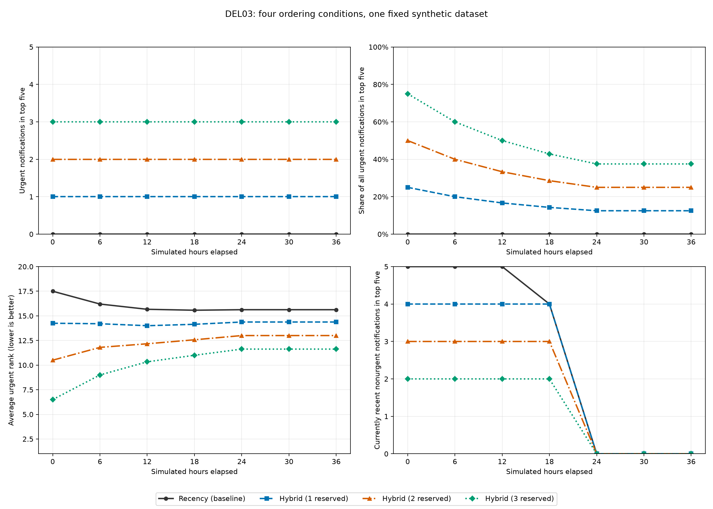

# DEL03: reserved urgent position comparison

## Experiment and reproducibility

This experiment reuses `run_condition()` from `src/project_model/run_comparison.py` and the unchanged Mesa agent/model/ordering code. The conditions are recency (baseline) and hybrid with 1, 2, or 3 reserved urgent positions. All four use the same `data/notifications.csv`: 20 fictional notifications, four initially urgent, a 72-hour urgency threshold, five visible positions, six six-hour steps plus step 0, and seed 42. The process is deterministic; there are no random draws, arrivals, removals, or student agents.

Hybrid promotes the newest currently urgent postings, then fills the remainder by recency. It does not sort by closest deadline. Urgent totals at hours 0, 6, 12, 18, 24, 30, 36 are 4, 5, 6, 7, 8, 8, 8 in every condition. N05, N06, N07, and N08 cross the urgency threshold at hours 6, 12, 18, and 24. Rankings differ, but all input/time/urgency states are checked equal across conditions.

Use the Python environment installed according to the root README:

```powershell
python -m src.project_model.run_del03
python -m pytest -q
```

The DEL03 runner defaults to `outputs/del03/` and refuses a nonempty output directory. To reproduce without replacing the saved results:

```powershell
python -m src.project_model.run_del03 --output-dir .venv/audit/del03_repeat
```

It accepts the existing input, step, hours-per-step, and seed settings. The four conditions, 72-hour threshold, and five-position measurement are fixed for this experiment. It rejects runs reaching the earliest deadline. This does not add urgency-only ordering or other notification volumes.

## Definitions

- Urgent visibility: count of urgent notifications in positions 1-5.
- Urgent coverage (`urgent_top5_share`): visible urgent count divided by the number of currently urgent notifications, not the fraction of visible slots that are urgent.
- Average urgent rank: mean position of all currently urgent notifications; smaller values indicate higher placement. Its population changes when notifications become urgent.
- Recent nonurgent visibility: nonurgent notifications in positions 1-5 whose current posting age is at most 24 hours.
- Initial recent nonurgent cohort: notifications that were recent and nonurgent at step 0; membership stays fixed. This supporting metric separates displacement from aging out of the recency window.

## Actual numerical results

### Urgent visibility (count)

| Hours | Recency | Hybrid 1 | Hybrid 2 | Hybrid 3 |
|---:|---:|---:|---:|---:|
| 0 | 0 | 1 | 2 | 3 |
| 6 | 0 | 1 | 2 | 3 |
| 12 | 0 | 1 | 2 | 3 |
| 18 | 0 | 1 | 2 | 3 |
| 24 | 0 | 1 | 2 | 3 |
| 30 | 0 | 1 | 2 | 3 |
| 36 | 0 | 1 | 2 | 3 |

### Urgent coverage

| Hours | Recency | Hybrid 1 | Hybrid 2 | Hybrid 3 |
|---:|---:|---:|---:|---:|
| 0 | 0.00% | 25.00% | 50.00% | 75.00% |
| 6 | 0.00% | 20.00% | 40.00% | 60.00% |
| 12 | 0.00% | 16.67% | 33.33% | 50.00% |
| 18 | 0.00% | 14.29% | 28.57% | 42.86% |
| 24 | 0.00% | 12.50% | 25.00% | 37.50% |
| 30 | 0.00% | 12.50% | 25.00% | 37.50% |
| 36 | 0.00% | 12.50% | 25.00% | 37.50% |

### Average urgent rank

| Hours | Recency | Hybrid 1 | Hybrid 2 | Hybrid 3 |
|---:|---:|---:|---:|---:|
| 0 | 17.5000 | 14.2500 | 10.5000 | 6.5000 |
| 6 | 16.2000 | 14.2000 | 11.8000 | 9.0000 |
| 12 | 15.6667 | 14.0000 | 12.1667 | 10.3333 |
| 18 | 15.5714 | 14.1429 | 12.5714 | 11.0000 |
| 24 | 15.6250 | 14.3750 | 13.0000 | 11.6250 |
| 30 | 15.6250 | 14.3750 | 13.0000 | 11.6250 |
| 36 | 15.6250 | 14.3750 | 13.0000 | 11.6250 |

### Currently recent nonurgent visibility (count)

| Hours | Recency | Hybrid 1 | Hybrid 2 | Hybrid 3 |
|---:|---:|---:|---:|---:|
| 0 | 5 | 4 | 3 | 2 |
| 6 | 5 | 4 | 3 | 2 |
| 12 | 5 | 4 | 3 | 2 |
| 18 | 4 | 4 | 3 | 2 |
| 24 | 0 | 0 | 0 | 0 |
| 30 | 0 | 0 | 0 | 0 |
| 36 | 0 | 0 | 0 | 0 |

### Initial recent nonurgent cohort visibility (count)

| Hours | Recency | Hybrid 1 | Hybrid 2 | Hybrid 3 |
|---:|---:|---:|---:|---:|
| 0 | 5 | 4 | 3 | 2 |
| 6 | 5 | 4 | 3 | 2 |
| 12 | 5 | 4 | 3 | 2 |
| 18 | 5 | 4 | 3 | 2 |
| 24 | 5 | 4 | 3 | 2 |
| 30 | 5 | 4 | 3 | 2 |
| 36 | 5 | 4 | 3 | 2 |

### Interpretation

In this dataset, each additional reserved position increases urgent top-five visibility by one and displaces one member of the initially recent nonurgent cohort. The counts remain constant within each condition: urgent visibility is 0/1/2/3 and cohort visibility is 5/4/3/2. Hybrid 3 provides the highest urgent coverage and lowest average urgent rank among the four tested conditions, while keeping fewer recent nonurgent items visible. No weighting or preference function was specified, so these results do not establish a uniquely best policy.

As the urgent population increases from four to eight, coverage falls even though urgent visibility is constant. Initial/final coverage is 0%/0%, 25%/12.5%, 50%/25%, and 75%/37.5%. At hour 24 every current recent-nonurgent count becomes zero because the newest posting is 25 hours old. Items have not been removed; the initial-cohort measure continues to expose the capacity trade-off.

Average ranks at different times concern different urgent populations. Under recency, its mean can improve without any notification moving. Under hybrid 3, the mean worsens from 6.5 to 11.625 as the urgent population grows, while still remaining better than the other tested conditions at every matching snapshot.

At hour 36, hybrid 3 shows N05, N06, N01, N09, N10; hybrid 2 shows N05, N06, N09, N10, N11; hybrid 1 shows N05, N09, N10, N11, N12; recency shows N09, N10, N11, N12, N13. N01 is more imminent than N05/N06, illustrating that hybrid prioritizes urgent postings by recency rather than deadline proximity.

The summary CSV contains initial/final values and arithmetic means of the seven recorded snapshots including step 0. Those means are descriptive summaries, not independent replications, inferential estimates, or continuous-time averages.

## Graphs



The six generated graphs were visually inspected. Conditions have consistent colors, markers, and line styles; coverage uses a 0-100% scale, counts use 0-5, and mean rank uses the 1-20 list range. Five standalone figures also include initial-cohort visibility, which is not in the four-panel overview. The nonurgent series overlap at zero after hour 24; the tables preserve all exact counts.

## Output inventory

All new result files are under `outputs/del03/`:

- `recency_raw_model.csv`, `hybrid_1_raw_model.csv`, `hybrid_2_raw_model.csv`, `hybrid_3_raw_model.csv`: seven snapshots each.
- `recency_raw_agent_states.csv`, `hybrid_1_raw_agent_states.csv`, `hybrid_2_raw_agent_states.csv`, `hybrid_3_raw_agent_states.csv`: 140 agent rows each.
- `comparison_raw_model_metrics.csv`: 28 labeled model snapshots, including policy and reserved count.
- `comparison_processed_metrics_wide.csv`: seven rows with side-by-side metrics for all conditions.
- `comparison_processed_summary.csv`: four condition rows, initial/final values and snapshot means.
- `comparison_processed_urgent_top5_count.png`.
- `comparison_processed_urgent_top5_share.png`.
- `comparison_processed_average_urgent_rank.png`.
- `comparison_processed_recent_nonurgent_top5.png`.
- `comparison_processed_initial_recent_nonurgent_top5.png`.
- `comparison_processed_overview.png`.
- `run_metadata.json`: condition settings, input SHA-256, versions, metric interpretation limits.

## File-integrity provenance

The saved metadata's `input_sha256` describes the actual CRLF input bytes consumed by the Windows execution, not Git-normalized input. The historical input SHA-256 is `4ca083de76bc24d5bc6a69bfe3647ca88f1652c721c18deaf46d560d21df219d`; the repository LF content has SHA-256 `bf93f1889d199348d529197e2d5dda0d413fef321c81bcafc619f22aa24f1f2e`. Both are recorded in [E6](evidence/records/E6_synthetic_dataset.md). [E10](evidence/records/E10_del03_computational_outputs.md) lists original Windows and repository-content fingerprints for all 18 artifacts; [E9](evidence/records/E9_del02_snapshot.md) distinguishes inspected Windows bytes from the unchanged published DEL02 bytes. All identified file differences are exclusively CRLF/LF normalization. Saved metadata and outputs remain unedited.

A fresh Windows run again reproduced all 18 artifacts exactly. A separate execution with LF repository input on the same Windows runtime preserved all values and reproduced all 11 CSVs after newline normalization and all six PNGs exactly; metadata differed only in its correctly recorded LF runtime input hash. This is not an actual Linux/macOS run or a claim of cross-platform byte equality. See [file-integrity conventions and verification commands](evidence/file_integrity.md) before checking a downloaded version.

## Verification and limitations

The full suite passes 18 tests (10 existing Mesa seed-deprecation warnings; no skips). New end-to-end tests independently reconstruct every rank and model metric from the input records at all seven snapshots in all four conditions, inspect all 560 agent rows, reconcile long/wide/summary tables, check the DEL02 baseline and hybrid-2 CSVs, and exercise output-overwrite and invalid-time safeguards. Recency and hybrid 2 match the existing DEL02 model and agent CSVs exactly. Original output and original Mesa example file hashes, dataset/model source, and the DEL02 annotated tag/commit are checked unchanged.

Runtime: Python 3.12.14, Mesa 3.5.2, pandas 2.3.3, matplotlib 3.11.2, pytest 9.2.0. Windows Application Control blocked the old `.venv/Scripts/python.exe`; verification instead used the available bundled Python 3.12.14 with the already installed project dependencies. No security policy was changed. Historically, PowerShell invoked that executable through `$python`, with `PYTHONPATH` pointing to `.venv/Lib/site-packages`, then ran `-m src.project_model.run_del03` and `-m pytest -q`. The machine-specific executable path is omitted for portability. The subsequent pre-release audit reproduced all 18 artifacts byte-for-byte in a fresh ignored directory on the same Windows runtime and again passed all 18 tests. This does not establish cross-platform byte-identical reproduction.

For a new checkout, install the documented dependencies using the root README and use the environment's Python. The following is a portable reproduction example, not a transcript of the historical invocation:

```bash
python -m src.project_model.run_del03 --output-dir .venv/results/del03_reproduction
python -m pytest -q
```

Here `python` means the activated environment's interpreter; alternatively use the explicit Windows or macOS/Linux environment paths in the README. Choose another new output directory for repeat runs.

This is one intentionally constructed deterministic synthetic dataset, not evidence of actual eClass ordering, student reading, attention, missed deadlines, or learning outcomes. More reserved slots improve the measured urgent outcomes here but reduce visible space for other information. Results cannot be generalized to other datasets or volumes without further experiments. No urgency-only policy, additional volume, commit, push, or DEL03 release was created. DEL02 files and release remain preserved.
